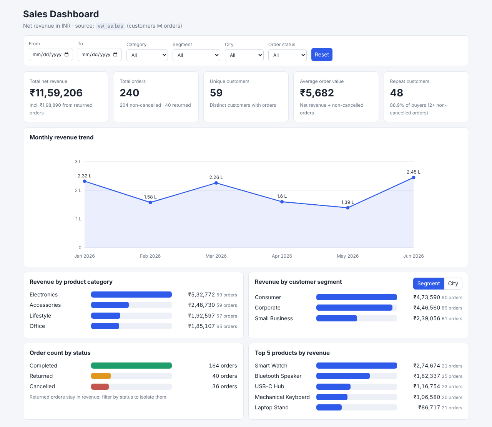

# Sales Dashboard (Excel -> SQL database -> FastAPI -> interactive dashboard)

An interactive sales dashboard built from `customers.xlsx` and `orders.xlsx`.
The Excel data is loaded into a relational database (with a primary key, a foreign key and
constraints), joined through a SQL view, and served by a FastAPI backend to a single-page dashboard.



## Tools used
| Layer | Tool |
|---|---|
| Database | SQLite (single file `sales.db`, no install needed) |
| Loading | Python + openpyxl (`scripts/load_data.py`) |
| Backend / API | FastAPI + Uvicorn (all metrics computed in SQL) |
| Frontend | React 19 + Vite, JavaScript (JSX), HTML/CSS; reusable components, custom hooks, charts drawn as SVG/CSS |
| Tests | `unittest` + pandas (SQL results cross-checked against an independent calculation) |

## Quick start
Requires Python 3.9+ (and Node 20.19+ only if you want to modify/rebuild the React frontend).

```bash
python -m venv .venv
source .venv/bin/activate          # Windows: .venv\Scripts\activate
pip install -r requirements.txt

python scripts/load_data.py        # creates sales.db from data/*.xlsx and verifies it
uvicorn app.main:app --reload      # then open http://127.0.0.1:8000
```
A pre-built copy of the React app is included in `frontend/dist`, so the commands above are enough.
Interactive API docs (FastAPI): http://127.0.0.1:8000/docs

**Frontend development (React + Vite)** - run the API as above, then in a second terminal:
```bash
cd frontend
npm install
npm run dev                       
```

**Docker (optional bonus):** `docker compose up --build` then open http://localhost:8000

**Run the tests:** `pip install -r requirements-dev.txt && python -m unittest discover -s tests -v`

## Project structure
```
data/customers.xlsx, orders.xlsx   source files
sql/01_schema.sql                  table creation (types, PK, FK, constraints, indexes)
sql/02_view.sql                    vw_sales: the customers-orders join used by the dashboard
sql/03_metric_queries.sql          reference SQL for every KPI/chart
scripts/load_data.py               loads Excel into the DB and reconciles counts/revenue
app/db.py                          query layer (filters + metrics, parameterised SQL)
app/main.py                        FastAPI app (/api/filters, /api/dashboard) + serves frontend/dist
frontend/                          React + Vite app
  src/App.jsx                      page layout, filter state
  src/components/                  Filters, KpiCard, LineChart, BarList
  src/hooks/useDashboard.js        data fetching hooks (aborts stale requests)
  src/api.js, format.js            API client, INR/number formatting
  dist/                            pre-built output served by FastAPI
tests/test_metrics.py              metric accuracy tests
```

## Data model
```
customers (1) ----< orders (many)
  Customer_ID  PK     Order_ID     PK
  ...                 Customer_ID  FK -> customers.Customer_ID (ON DELETE RESTRICT)
```
* Types: text IDs, `INTEGER` quantity, `NUMERIC` money, `REAL` discount, `DATE` (stored as ISO `YYYY-MM-DD`).
* Constraints: `Email` unique, `Order_Status IN (Completed, Returned, Cancelled)`, `Quantity > 0`,
  discount between 0 and 1, and **cancelled orders must have `Net_Amount_INR = 0`**.
* The join is the view `vw_sales` (`orders JOIN customers ON Customer_ID`), one row per order.
* The loader runs in one transaction and then asserts: row counts match Excel, the view neither drops
  nor duplicates rows, total revenue matches Excel, and `PRAGMA foreign_key_check` is clean.

## Dashboard contents
* **KPIs:** total net revenue, total orders, unique customers, average order value (+ bonus: repeat customers).
* **Charts:** monthly revenue trend, revenue by product category, revenue by customer segment *or* city (toggle),
  order count by status, and (bonus) top 5 products.
* **Filters (6):** date range (from / to), product category, customer segment, city, order status.
  Every KPI and chart responds to every filter.
* **Returned orders** are identifiable via the status chart, the "returned" counts in the KPI cards,
  and by selecting *Returned* in the status filter.

## Metric definitions (business rules)
| Metric | Definition |
|---|---|
| Total net revenue | `SUM(Net_Amount_INR)` (cancelled orders are 0 by rule) |
| Total orders | `COUNT(DISTINCT Order_ID)` (all statuses) |
| Unique customers | `COUNT(DISTINCT Customer_ID)` among the orders in the current view |
| Average order value | net revenue / `COUNT(DISTINCT Order_ID)` of **non-cancelled** orders (0 if none) |
| Repeat customers (bonus) | customers with 2+ non-cancelled orders; rate = repeat / customers with 1+ non-cancelled order |

Headline figures on the full data: revenue INR 11,59,206 | 240 orders (204 non-cancelled, 40 returned,
36 cancelled) | 59 customers | AOV INR 5,682.

## Assumptions
1. **Returned orders are included in net revenue** because the brief keeps them in the data and only asks that
   they be identifiable by status. Select status *Completed* to see revenue excluding returns.
2. "Total orders" counts every unique `Order_ID` including cancelled/returned ones; only the AOV denominator
   excludes cancelled orders, exactly as specified.
3. 59 of the 60 customers have orders (`C0060` has none). The view uses an inner join, so "unique customers"
   counts customers who placed orders in the selected view.
4. Monthly trend is grouped by calendar month of `Order_Date`; months with no orders in the selected range show as 0.
5. SQLite has no native date type, so dates are stored as ISO text, which sorts and filters correctly.
6. Data checks on the supplied files: no missing values, no duplicate IDs, no orphan `Customer_ID`s,
   `Net_Amount_INR` = quantity x price x (1 - discount) for all non-cancelled rows.


## Clear database script

To remove all customer and order data while recreating the complete SQLite schema and view:

```bash
cd backend
source .venv/bin/activate
python scripts/clear_database.py
```

To reload the Excel data after clearing:

```bash
python scripts/load_data.py
```

The clear script does not modify source Excel files or application code. Set `SALES_DB` in `backend/.env` to clear a custom database path.
